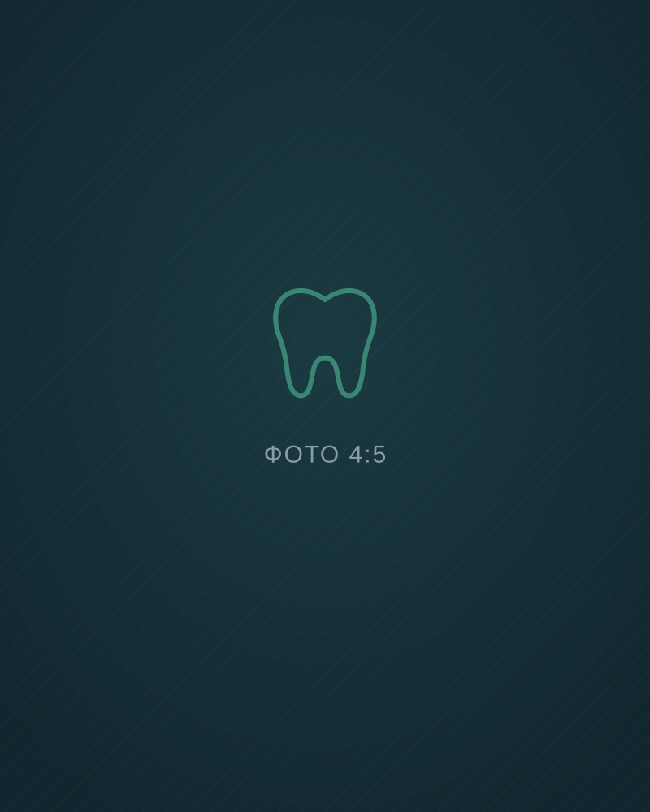

# PHOTOS.md — список кадрів для зйомки

У сайті п'ять місць під фото. Поки там стоять заглушки в кольорах палітри з підписом, що має бути на кадрі. Перший екран зроблено графікою, тому фото на ньому немає: усі фото вантажаться ліниво (`loading="lazy"`), і в кожного прописані `width` і `height`, щоб сторінка не «стрибала».

## Загальний стиль

- **Світло:** денне, м'яке, з вікна або софтбокса. Без жорсткого спалаху, без жовтих ламп.
- **Колір:** холодний нейтральний баланс білого. У кадрі бажані м'ятні або бірюзові деталі (форма, рушник, стіна) і одна тепла коралова (рукавички, серветка, губи). Фон сайту темний, тому кадри з темним краєм і світлим центром виглядатимуть найкраще.
- **Люди:** живі, не постановочні пози. Лікарі в робочій формі, без масок на портретах. Пацієнтів знімаємо лише з письмової згоди.
- **Без:** стокових усмішок «на камеру», інструментів крупним планом із кров'ю, логотипів чужих брендів.

## Кадри

| # | Файл (`assets/img/`) | Що на кадрі | Орієнтація | Пропорції | Розмір експорту | Де на сайті |
|---|---|---|---|---|---|---|
| 1 | `visit-talk.webp` | Розмова в кабінеті **до крісла**: лікарка за столом показує пацієнтці знімок її зубів на моніторі. Обидві усміхаються, видно екран | горизонтальне | 3:2 | 1200×800 | Сцена 2 «Перший візит», під кроками |
| 2 | `doctor-tkach.webp` | Олена Ткач біля стоматологічного мікроскопа, погляд у камеру, рука на окулярі | вертикальне | 4:5 | 800×1000 | Сцена 5 «Лікарі», перша картка |
| 3 | `doctor-hrebeniuk.webp` | Андрій Гребенюк тримає навчальний макет щелепи з імплантом, пояснює жестом | вертикальне | 4:5 | 800×1000 | Сцена 5, друга картка |
| 4 | `doctor-lysenko.webp` | Марта Лисенко в дитячому кабінеті, на стелі мультфільм, у руках дзеркальце й наліпки | вертикальне | 4:5 | 800×1000 | Сцена 5, третя картка |
| 5 | `entrance.webp` | Вхід з вулиці Соборної: скляні двері, вивіска «Емаль», вечір, світло з вітрини. Видно, що вхід без сходинок | горизонтальне | 4:3 | 1200×900 | Сцена 6 «Запис», картка контактів |

Портрети лікарів знімайте в одній локації й з одним світлом, щоб три картки виглядали як серія.

## Як підготувати WebP

Експортуйте з Lightroom або Photoshop у JPEG максимальної якості, потім конвертуйте у WebP:

```bash
cwebp -q 78 -resize 1200 0 visit-talk.jpg -o assets/img/visit-talk.webp
```

Або через ffmpeg, якщо `cwebp` не встановлено:

```bash
ffmpeg -i doctor-tkach.jpg -vf "scale=800:-2" -c:v libwebp -quality 78 assets/img/doctor-tkach.webp
```

Орієнтир — до 150 КБ на портрет і до 220 КБ на горизонтальний кадр.

## Як замінити заглушку

У `index.html` біля кожної заглушки є коментар з потрібною назвою файлу, наприклад:

```html
<figure class="shot shot--4x5">
  <!-- Фото: assets/img/doctor-tkach.webp (кадр 2) -->
  
  <figcaption class="shot__brief" aria-hidden="true">Кадр 2 · …</figcaption>
</figure>
```

1. Покладіть файл у `assets/img/`.
2. Замініть `src` на назву файлу (`assets/img/doctor-tkach.webp`). Якщо пропорції збігаються з таблицею, `width` і `height` чіпати не треба.
3. Видаліть рядок `<figcaption class="shot__brief">…</figcaption>` — це підказка для зйомки.
4. Перевірте `alt`: він уже описує кадр, але підправте, якщо на фото інше.

## Картинка для соцмереж

`assets/og-image.jpg` (1200×630) зараз — кадр першого екрана сайту. Коли буде фото входу або команди, можна зробити нову: фото ліворуч, назва «Емаль» праворуч, той самий темний фон.
